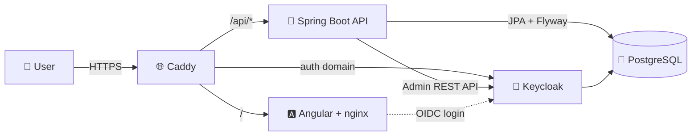

<div align="center">

# 🥩 CarniFlow

**Business management for a meat distribution business: clients, suppliers, purchases, real stock by cut, sales, payments and cash, all in one place.**


</div>

---

## 📖 What is this?

CarniFlow is a web application that replaces spreadsheet-based bookkeeping for a
meat distribution business. It tracks the whole cycle:

> 🐄 **buy** whole pieces from suppliers → ✂️ **cut** them into sellable units →
> 💰 **sell** those units to client butcher shops → 🧾 **collect** payments →
> 📊 **know** your balances, cash and margins at any time.

Every user sees **only their own data**. Several people (or businesses) can use the same
installation without ever seeing each other's information.

> 📝 **Naming note:** the product is called **CarniFlow**, but internal identifiers keep
> the original project name `sistema-gestion` on purpose (Keycloak realm, database name,
> Java package, login theme folder).

## ✨ What it improves

| Before (spreadsheets) | With CarniFlow |
|---|---|
| Balances recalculated by hand | 🧮 Client and supplier **current accounts** recalculated automatically |
| No link between what you bought and what you sold | 🔗 **Full traceability**: every sold unit points to its purchase and supplier |
| Stock is a guess | 📦 **Real stock**: you can only sell cuts that exist (FIFO proposal, manual override) |
| A bounced cheque means editing old rows | ↩️ Rejected cheques are **linked reversals**, so history is never rewritten |
| One shared file, anyone can edit | 🔐 **Authentication, roles and per-user data isolation** |
| Reports built manually | 📈 **Dashboard** with KPIs, monthly comparison, flow chart and rankings |
| Manual backups, if any | 💾 **Backup and restore scripts**, tested end to end |

## 🧩 Features

### 👥 Clients and suppliers
- Client **butcher shops** and suppliers (🐄 bovine, 🐖 porcine or both).
- Each one has a **current account** with its movements and running balance.
- Name uniqueness is validated per user, with async checks in the forms.

### 🛒 Purchases and 📦 Stock
- Register purchases by supplier, kilograms, units and **purchase type** (configurable per user).
- Each purchase is split into **pieces** (even split, or manual per-piece weights).
- A piece can be **cut** into units (Asado, Vacío, ...), each one with its own weight. What
  is not cut counts as *merma* (shrink).
- A piece is closed manually as **"Vendida"** (reversible) once all its cuts are sold.

### 💰 Sales
- Sales are made **only from available cuts**: no cuts, no sale.
- The system **proposes the oldest piece first (FIFO)** and you can override it.
- A cut unit is sold whole; editing or deleting a sale **releases its units** again.
- Double sale is prevented with an atomic claim on each unit.

### 🧾 Payments and ↩️ cheque rejection
- Payment methods: 💵 cash, 🏦 transfer, 🧾 cheque, and 🔁 *supplier transfer* (the client
  paid a supplier directly, mirrored in both accounts).
- **Custom payment methods** per user.
- A rejected cheque creates a new `CHECK_REJECTION` payment linked to the original. The
  original is never modified, so closed periods stay intact.

### 🏧 Cash ("Caja / Ahorro")
- Daily cash view and balance, built from collections and payments.
- Rejected cheques are subtracted automatically.

### 📊 Dashboard
- KPI cards, monthly summary, month-over-month comparison, flow chart (Chart.js),
  rankings and recent movements.

### 📤 Excel export
- One click downloads a **ZIP** with an Excel file for clients and one per supplier
  (Apache POI).

### 🔐 Users and security
- Login with **Keycloak** (OIDC, PKCE). The backend validates JWTs, including audience.
- Roles `ADMIN` and `USER`. Only `ADMIN` can manage users (create, change role, disable,
  re-activate) from the **Usuarios** section.
- Data isolation per owner using Hibernate `@TenantId` (the Keycloak `sub` claim).
- Profile, password and active sessions are managed through Keycloak's Account API.
- Custom Spanish login theme.

### 🎨 Personalization
- Light / dark / system theme and accent colors.

## 🏗️ Architecture



| Layer | Technology |
|---|---|
| 🖥️ Frontend | Angular 20 (standalone, lazy routes), Tailwind CSS 4, Chart.js, Font Awesome, keycloak-angular |
| ⚙️ Backend | Java 21, Spring Boot 4.1, Spring Data JPA, Spring Security (OAuth2 resource server and client), Bean Validation, Lombok, Apache POI |
| 🗄️ Database | PostgreSQL 17, schema versioned with **Flyway** (V1 to V10) |
| 🔑 Identity | Keycloak 26.8 with a realm exported in `infra/keycloak` |
| 🚪 Edge (prod) | Caddy 2 with automatic Let's Encrypt HTTPS |
| 🧪 Tests | JUnit 5, Mockito, Spring test, Testcontainers |

### 📁 Repository layout

```
SistemaGestion/
├── backend/            # Spring Boot API (controller, service, repository, model, dto, mapper)
├── frontend/           # Angular app (feature folders: dashboard, stock, cash, movements, ...)
├── infra/
│   ├── caddy/          # Reverse proxy config (production)
│   ├── keycloak/       # Realm export + custom login theme
│   └── postgres/init/  # Creates the keycloak role and database on first start
├── scripts/backup.ps1  # Database backups
├── compose.yaml        # Local development infrastructure
└── compose.prod.yaml   # Full production stack
```

## 🚀 Daily use (development)

**Requirements:** Docker, Java 21, Node.js (with npm).

```powershell
docker compose up -d
```

Starts PostgreSQL (`127.0.0.1:5433`) and Keycloak (`127.0.0.1:8081`). Then:

```powershell
# 1. Backend (see "Backend configuration" below)
cd backend
./mvnw spring-boot:run

# 2. Frontend
cd frontend
npm install
npm start          # http://localhost:4200
```

`docker compose down` keeps the data. ⚠️ **Never run `docker compose down -v`**: it deletes
the database volume.

### 🧪 Tests

```powershell
cd backend
./mvnw test
```

## ⚙️ Configuration

Copy `.env.example` to `.env` and fill in the values. `.env` is not versioned and is not
part of the backups: keep a copy in a password manager. Keycloak stores
`BACKEND_ADMIN_SECRET` in its database on the first import (later imports are skipped),
so after a restore the value must be the original one.

### Backend configuration

`application.yaml` reads every environment-specific value from a placeholder. For local
development, copy `backend/application-local.example.yaml` to
`backend/src/main/resources/application-local.yaml` (git-ignored) and fill in the values
marked with `<...>`. The `local` profile is active by default.

| Setting | Environment variable | Local value |
|---|---|---|
| Database URL | `DB_URL` | `jdbc:postgresql://localhost:5433/sistema_gestion` |
| Database user | `DB_USERNAME` | `POSTGRES_USER` from `.env` |
| Database password | `DB_PASSWORD` | `POSTGRES_PASSWORD` from `.env` |
| Token issuer | `KEYCLOAK_ISSUER_URI` | `http://localhost:8081/realms/sistema-gestion` |
| Keycloak base URL | `KEYCLOAK_BASE_URL` | `http://localhost:8081` |
| Admin API secret | `BACKEND_ADMIN_SECRET` | same value as in `.env` |
| Allowed CORS origins | `CORS_ALLOWED_ORIGINS` | `http://localhost:4200` |
| Initial data owner | `INITIAL_OWNER_ID` | any valid UUID (see below) |

Outside local development, set those environment variables instead of using the local file.

`INITIAL_OWNER_ID` is only used by Flyway migration V3 (data ownership). On an empty or
restored database it has no effect, but it must be a valid UUID. When migrating a database
that already has data, use the Keycloak `sub` of the admin user (Keycloak console >
Users > Details > ID).

## 🌍 Production

`compose.prod.yaml` runs the full stack (PostgreSQL, Keycloak, backend, frontend and
Caddy). The database is not exposed to the host, and Caddy terminates HTTPS.

1. Point two DNS records (`APP_DOMAIN` and `AUTH_DOMAIN`) to your server.
2. Copy `.env.prod.example` to `.env` and replace every `cambiar_esta_contrasena`.
3. Start it:

```bash
docker compose -f compose.prod.yaml up -d --build
```

| Domain | Serves |
|---|---|
| `APP_DOMAIN` | the app (`/api/*` goes to the backend, everything else to the frontend) |
| `AUTH_DOMAIN` | Keycloak login |

## 💾 Backup

```powershell
.\scripts\backup.ps1
```

Writes `backups/<database>-<timestamp>.dump` for `sistema_gestion` and `keycloak` and keeps
the last 14 of each. They live on the same disk as Docker, so copy `backups/` to an
external drive or cloud storage regularly.

## ♻️ Restore (new machine or lost volume)

1. Clone the repo and recreate `.env`. `POSTGRES_USER` must be `postgres`, the owner of the
   objects inside the dumps.
2. `docker compose up -d postgres`. On an empty volume it creates the `keycloak` role and
   database (`infra/postgres/init`).
3. Copy and restore the dumps, using the timestamps of the files you have:

```powershell
docker compose cp backups\sistema_gestion-<timestamp>.dump postgres:/tmp/sg.dump
docker compose cp backups\keycloak-<timestamp>.dump postgres:/tmp/kc.dump
docker compose exec -T postgres sh -c 'pg_restore -U $POSTGRES_USER -d sistema_gestion --exit-on-error /tmp/sg.dump'
docker compose exec -T postgres sh -c 'pg_restore -U $POSTGRES_USER -d keycloak --exit-on-error /tmp/kc.dump'
docker compose up -d
```

Tested end to end: Flyway history, row counts and the Keycloak realm come back intact.